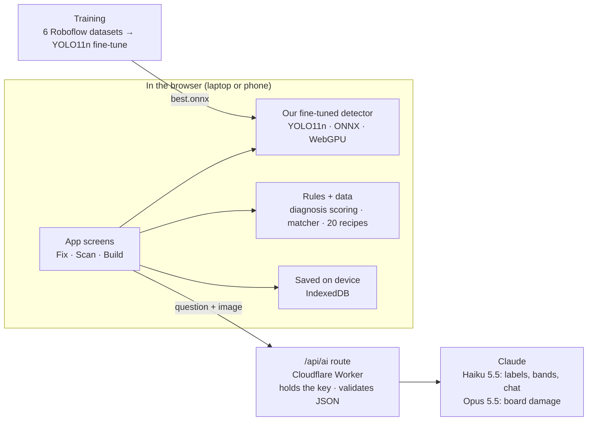

# ElectroQuest

**Fix it. Salvage it. Build with it.**

ElectroQuest is a web app that helps anyone repair broken battery-powered gadgets, turn the ones that can't be saved into spare parts, and learn electronics by building projects from those parts — guided by AI and our own fine-tuned vision model.

**Live:** [electroquest.pages.dev](https://electroquest.pages.dev) · Built for the PineQuest *"Fine-tune for the future"* hackathon (theme: equal access to skills).

---

## Why

In Mongolia, a broken TV remote or game controller usually goes to a repair shop or the trash. Most failures are simple — a dead battery, corroded contacts, worn button pads — and anyone could fix them with the right guidance. Repairing and building teaches real electronics skills, and every saved device is less e-waste.

## What it does

| | Feature | How |
|---|---|---|
| 🔧 | **Fix it** | The AI works like a repair technician: it asks questions, runs phone-only tests (IR camera test, multimeter photo), looks at a photo of the opened board, then ranks the likely causes with a fix plan, the parts, and the cost versus a repair shop (e.g. **500₮ instead of 15,000₮**). |
| ♻️ | **Salvage it** | If the device can't be fixed, the app scans the board and moves its reusable parts into your parts list. |
| 💡 | **Build with it** | Like [Brickit](https://brickit.app) for LEGO: scan a pile of parts, see which of **20 beginner projects** you can build right now (or which one part to buy), with the parts highlighted on your own photo and step-by-step breadboard guidance. |

Supported devices: TV/AC remotes, garage/gate remotes and game controllers — battery-powered only. The app never guides repairs inside anything that plugs into the wall.

Mongolian by default, with an English toggle. Works offline for everything except AI calls.

## How it works



**The key design rule: AI reads and explains, our code decides.**

- **Our own model** finds parts in a photo — in the browser, ~50 ms per photo, photos never leave the device.
- **Claude** reads what a detector can't: chip markings, resistor colour bands, a multimeter display, visible board damage — and answers questions in the user's language. Every answer is schema-checked JSON.
- **Plain code with tests** makes the decisions: the order of diagnosis questions and the cause scoring, resistor values from colours, and which projects your parts can build. Claude can never invent a circuit or a part value.
- **Safety in code:** anything mains-powered (220V) is refused before the AI is even asked.

## Our fine-tuned model

| | |
|---|---|
| Base model | YOLO11n, pre-trained on COCO |
| Training data | 6 public [Roboflow Universe](https://universe.roboflow.com) datasets, ~7,600 labelled images, remapped onto our 18 part classes |
| Classes | resistor, capacitor, LED, diode, transistor, IC, button, buzzer, potentiometer, LDR, battery, breadboard, Arduino, jumper wire, servo, DC motor, ultrasonic sensor, display |
| Current live model | mAP50 **0.66** (interim export after 10 epochs; training continues — see the in-app **Model card**) |
| Runs | In the browser via onnxruntime-web (WebGPU, WASM fallback) |

Train it yourself: [`training/README.md`](training/README.md) (local on a Mac/GPU with `training/train_local.py`, or the Colab notebook). Real metrics and example predictions are written to `data/model_card.json` and shown on the in-app Model card page.

## Tech stack

- **Next.js 16** (App Router) · TypeScript strict · Tailwind CSS 4 · lucide icons
- **Claude API** (`@anthropic-ai/sdk`) — structured outputs, versioned prompts in `prompts/`
- **onnxruntime-web** — our YOLO11 detector in the browser
- **IndexedDB** (`idb`) — local-first storage
- **zod** — validates every data file and every AI answer
- **Vitest** — 100+ tests (matcher, diagnosis scoring, resistor decoder, every recipe circuit checked against its schematic)
- **Cloudflare Workers** via OpenNext — hosting
- **Ultralytics YOLO11** + **Roboflow** — training

## Getting started

```bash
npm install                  # also copies the ONNX runtime into public/ort
cp .env.example .env.local   # add your ANTHROPIC_API_KEY
npm run dev                  # http://localhost:3000
```

1. Fix → TV remote → *Not at all* → the camera opens; beside it tap IR test *no flash*, *Just changed them*, *Neither*, *Not sure* → *Continue* → skip multimeter.
2. Open it → board photo (demo photo 1) → corroded battery contacts + cracked IR LED joint → fix plan: 500₮ vs 15,000₮ at a shop.
3. A teammate fixes it → *It works!*
4. Fix → TV remote again → … → demo photo 2 (burnt chip) → *Not worth fixing* → Salvage → parts (incl. an S8050 transistor) go to the inventory.
5. Build → scan → demo photo (parts pile) → read values → add → "You can build: Night light…" → parts highlighted on the photo → build step by step → cover the light sensor → it turns on.

| Command | What it does |
|---|---|
| `npm test` | Unit tests |
| `npm run check:data` | Validates every recipe and device file (runs before every build) |
| `npm run lint` / `npm run typecheck` | ESLint / TypeScript |
| `npm run build` | Production build |
| `node scripts/live-check.mjs http://localhost:3000` | Checks every Claude task against known images (needs an API key) |
| `npm run cf:deploy` | Build and deploy to Cloudflare |

## Demo mode

Open [`/?demo=1`](https://electroquest.pages.dev/?demo=1): demo photos appear next to the camera, recorded AI answers are replayed if the Wi-Fi drops, and all project levels are unlocked. Add `?present=1` (or press **P**) for the presenter panel with the run-of-show checklist, a timer and a demo reset.

## Project structure

```
app/            Pages (home, fix, scan, inventory, projects, build, progress, model card, debug) + /api/ai
components/     UI, camera, scan flow, build mode, repair flow
lib/            Detector, diagnosis engine, matcher, Claude client, storage, i18n
data/           Recipes, device profiles, parts catalogue, model card (JSON — editable without code)
prompts/        Versioned Claude prompts
training/       Training script + notebooks for the detector
shared/         The 18-class list shared by the app and the training code
tests/          Vitest suites
```

Adding a project or a device needs no code — copy a JSON file in `data/recipes/` or `data/devices/` and run `npm run check:data`; it catches miswired circuits, unsafe LED resistors and missing steps. Details in [PLAN.md](PLAN.md) and [DECISIONS.md](DECISIONS.md).

## Team

PineQuest Season 5 · Team 9.
